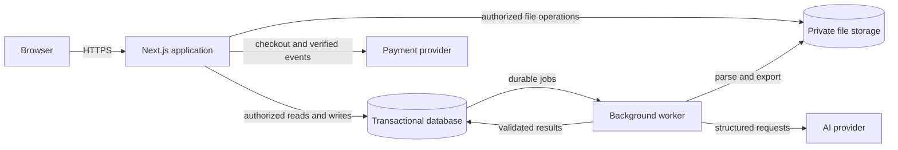

# Proposed application architecture

This design supports the candidate journey described in [application UI](application-ui.md), [CV analysis](ai-cv-parsing-and-scoring.md), and [training engine](training-engine.md). It is a design for implementation. Storage, model provider, payment provider, and hosting remain open decisions.

## Responsibilities and boundaries

- The Next.js server renders the public site, authenticates candidates using JWT-based sessions, checks ownership and entitlement, validates inputs, and exposes role-scoped operations to the UI. The browser holds only the data needed for the current screen.
- A transactional database stores accounts, preparations, immutable input versions, attempts, results, orders, and durable job state. Private object storage holds source CVs and generated files. Storage access is mediated by an authorized server operation.
- Workers extract text, request AI analysis or grading, and generate exports outside the request lifecycle. Provider adapters translate structured inputs and outputs so model or payment provider choices can change.
- Payment events enter a verified server endpoint. Credentials for external services stay on the server. Workers receive narrowly scoped access to required data.

## Records and ownership

Every preparation belongs to one account and references a target job version and CV version. A candidate can have several preparations. Require an ownership check on every preparation, attempt, and file read or mutation. The selected role in the dashboard is a view choice and never establishes authorization.

| Record | Important references and state |
| --- | --- |
| CV version | Owner, private file key, extraction status, validated claims and source excerpts. Corrections create a new version while retaining provenance. |
| Job version | Owner, submitted description, extracted requirement IDs and review status. |
| Comparison | Preparation, CV and job versions, rubric version, evidence per requirement, score and processing status. |
| Blueprint and item | Job version, required competencies, approved item family and version, difficulty, rubric and coverage requirements. |
| Attempt | Preparation and blueprint versions, mode, reserved items, draft revision, assistance history, submission time and frozen answers. |
| Grade and readiness | Attempt, rubric and grader versions, criterion evidence and scores, review decisions. Readiness references its ordered qualifying attempts and rule version. |
| Export | Preparation, source CV and profile versions, readiness decision, approved edit set, generation status and private file key. |
| Order and entitlement | Owner, preparation, offer snapshot, provider order, payment status and access period or allowance. |
| Job | Operation ID, type, owner and input versions, status, retry count and sanitized failure category. |

## End-to-end wiring

1. The candidate creates a preparation, uploads a validated file and supplies a job description. The server stores the file privately, records its version, and commits an extraction job with the database state.
2. The worker extracts text and structured claims. It validates schema and evidence references before saving results. The UI retrieves the status and offers source-based corrections. A correction creates a new version and makes dependent comparisons stale.
3. The candidate confirms the job. A comparison job records the exact CV, job, and rubric versions, evaluates requirement evidence, and saves the validated breakdown. The server computes the score. Coverage checks map requirements to an approved blueprint and sufficient unexposed item families.
4. The UI shows the coverage and offer. The server creates an order before redirecting to the provider. Verified payment events reconcile the provider transaction with the owner, amount, currency, and order before creating an entitlement.
5. Starting an attempt checks ownership, entitlement, blueprint coverage, and fresh item supply. It reserves the question set and freezes its versions. Draft saves use a revision check. Submission freezes confirmed answers and enqueues grading in the same transaction.
6. A worker grades against the frozen rubric and validates the evidence. A durable result updates the attempt and triggers readiness evaluation. Compute readiness in submission order using the applicable rule, including pending results and disputes. Practice remains available from the resulting feedback.
7. A qualifying readiness decision enables CV revision. The candidate reviews supported edits. An export job binds the approved edits, source versions, and readiness decision. Successful output becomes available through an authorized download. Retry uses the same logical operation.
8. Dashboard reads a role-scoped summary of persisted statuses, scores, and the recommended next action. Refresh or poll pending operations and reload after completion. Switching roles clears the previous summary while the new one loads.

## Consistency and recovery

Commit state changes and job creation together using a transactional outbox or a database-backed queue. Workers claim jobs with a lease, retry transient failures with bounded backoff, and expose a recoverable terminal failure. Use stable operation IDs and database uniqueness constraints for payment reconciliation, attempt submission, grading result, readiness decision, and export. Handle duplicate and out-of-order provider events by checking the current authoritative order state.

Before publishing worker output, recheck that the preparation exists, its owner and relevant versions still match, and its readiness decision remains valid. A stale result stays in history or is discarded according to retention policy and cannot replace the current result. Deletion marks the preparation unavailable immediately, cancels queued work where possible, and prevents in-flight jobs from publishing. Remove derived files and records according to the disclosed retention process. Reconcile interrupted deletion and storage cleanup.

An interrupted upload, grading job, or export retains its last durable state. The candidate sees pending, failed with retry, or complete. Payment confirmation is reconciled with the provider instead of asking the candidate to pay again. Record operation IDs, status, durations, retry counts, and sanitized error categories for support without CV text or candidate answers.

## API contracts and verification

Use authenticated, preparation-scoped server endpoints for setup, status, draft saves, submission, feedback, readiness, and exports. Each mutation validates the caller, source versions, allowed state transition, and request identifier. Return a stable resource ID and current status for asynchronous operations. A stale revision returns a conflict with the latest revision metadata. Keep payment webhook validation separate from browser callbacks.

Exercise these flows through the browser and connected services before marking features complete:

1. Compare a known CV and job, correct evidence while analysis is running, and finish old and new jobs in reverse order. Only the current version appears on the dashboard.
2. Submit once from two tabs, interrupt grading, and retry. Verify one frozen attempt, one result, and one readiness contribution.
3. Complete test checkout with a delayed and duplicated event, then a refund followed by a late success event. Verify order and access reflect the reconciled provider state.
4. Qualify, fail export, retry, and download the approved revision. Delete during another in-flight export and verify the deleted preparation cannot reappear.
5. Use two accounts and two roles to check every API and file link for ownership and correct role scope.

Confirm the database and queue technology, authentication lifecycle, file limits, provider retention terms, payment policy, and hosting topology before implementation. Establish backup restoration and worker recovery procedures using the selected infrastructure.
